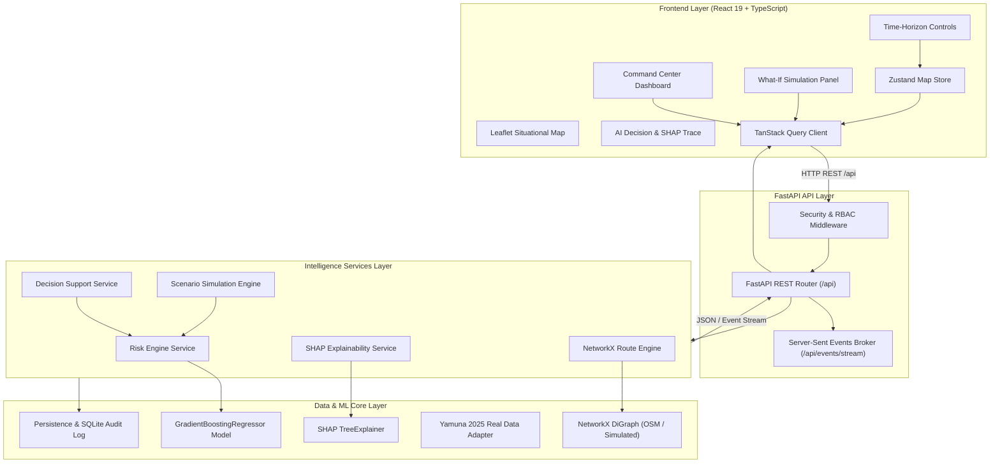
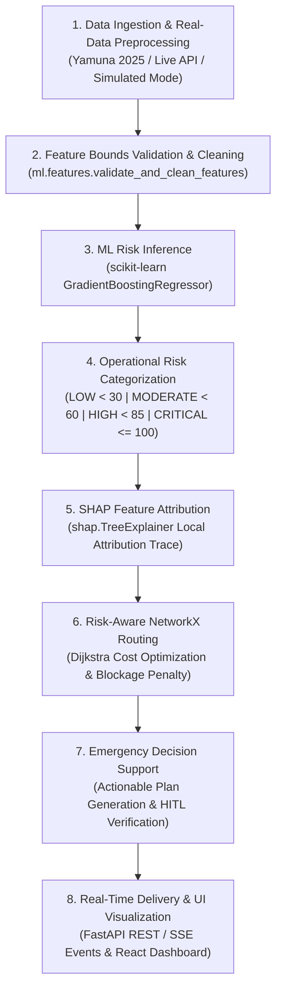

# AapdaNetra-X

**An Explainable AI-Driven Real-Time Disaster Intelligence and Emergency Response Optimization Platform**

AapdaNetra-X is an open-source, research-grade decision-support platform engineered for multi-hazard disaster monitoring, flood risk evaluation, explainable machine-learning inference, dynamic evacuation routing, and emergency decision support. Built with a decoupled FastAPI + React 19 architecture, the platform integrates **7-feature machine-learning risk prediction**, **SHAP local feature attributions**, **NetworkX risk-aware graph route optimization**, **counterfactual scenario simulation**, **event streaming**, and **human-in-the-loop (HITL) decision controls**.

> [!NOTE]
> **Research & Development Prototype Disclaimer**: AapdaNetra-X operates in **Research-Grade Local Prototype Mode**. The core Gradient Boosting Regressor (GBR) risk model was trained on synthetic physics-informed hydro-meteorological data (1,000 samples, fixed random seed `42`). Real historical Yamuna River flood data (July 2025 event) is integrated for preprocessing and alignment evaluation. The system is intended for research, architectural prototyping, and decision-support evaluation, and is **not** currently certified for live, autonomous life-safety emergency dispatch.

---

## 🌟 Key System Capabilities

- **7-Feature ML Risk Prediction**: `scikit-learn` GradientBoostingRegressor predicting continuous flood risk scores ($0.0 - 100.0$) from hydro-meteorological and spatial feature vectors.
- **SHAP Local Feature Explainability**: `shap.TreeExplainer` feature attributions providing decision trace explanations (*"Which physical drivers escalated the risk level?"*). Note: SHAP attributions reflect model feature importances and are not causal proofs.
- **Dynamic Risk-Aware Evacuation Routing**: NetworkX Dijkstra pathfinder evaluating road distance, travel time, traffic congestion, structural blockages, and predicted flood hazard exposure across simulated and OpenStreetMap (OSM) road networks.
- **Real-Data Preprocessing & Provenance (Yamuna 2025)**: Automated preprocessors for real CWC Hathnikund discharge rates, Yamuna Old Railway Bridge gauge levels, Delhi Traffic Police advisories, and IMD rainfall intensity.
- **Multi-Hazard Capability Matrix & Safeguards**: Native support for flood risk evaluation. Requests for unsupported hazards (e.g., `earthquake`, `landslide`, `cyclone`) return explicit `UNSUPPORTED_HAZARD` disclaimers (`decision_support_available: False`) rather than dangerous default fallback to flood models.
- **Human-in-the-Loop (HITL) Decision Support**: Recommended emergency response plans remain strictly in `RECOMMENDED` state until explicitly approved or rejected by authorized responders (`/api/decision/approve`, `/api/decision/reject`) with RBAC enforcement and reasoning audit trails.
- **Counterfactual What-If Scenario Simulation**: Real-time evaluation of physical interventions (evacuation pace, rainfall multipliers, drainage efficiency, road blockages).
- **Security & Production Hardening**: Bearer token and API key authentication, strict CORS origin white-listing, 1MB request body capping, IP sliding-window rate-limiting, SSE stream auth & subscription bounds, and sanitization of database/system tracebacks in error responses.

---

## 🏗️ System Architecture



---

## 🔬 7-Feature Intelligence Pipeline

The core intelligence pipeline processes 7 core hydro-meteorological and spatial parameters:

1. `rainfall_intensity` (mm/h)
2. `rainfall_trend` (mm/h² escalation rate)
3. `water_level` (meters above datum)
4. `water_level_trend` (m/h rising rate)
5. `road_congestion` (traffic congestion ratio $0.0 - 1.0$)
6. `population_exposure` (vulnerable population count)
7. `infrastructure_vulnerability` (asset vulnerability ratio $0.0 - 1.0$)

### Pipeline Execution Stages



---

## ⚡ Measured Empirical Performance Benchmarks

All micro-benchmarks were measured on the local host environment:

| Subsystem / Operation | Benchmark Latency | Operational SLA Target | Status |
| :--- | :--- | :--- | :--- |
| **ML Risk Prediction** (`predict_risk`) | **0.419 ms / op** | < 50 ms | **PASSED** |
| **ML SHAP Explainability** (`explain_prediction`) | **0.516 ms / op** | < 100 ms | **PASSED** |
| **Risk Engine Aggregation** (`compute_risk_state`) | **0.846 ms / op** | < 100 ms | **PASSED** |
| **Decision Support Recommendation** (`compute_emergency_decision`) | **1.794 ms / op** | < 200 ms | **PASSED** |
| **Counterfactual Scenario Simulation** (`run_simulation_engine`) | **3.508 ms / op** | < 500 ms | **PASSED** |

**End-to-End Decision Pipeline Execution Time**: **< 10.0 ms** total latency.

---

## 🧪 Verified Test Suite Results

* **Non-PostGIS Test Suite Execution**: **478 passed unit & integration tests**, 64 deselected, 3 warnings.
* **Tested Modules**: Data providers, ML predictor, SHAP explainer, GIS spatial risk, alert generation, simulation engine, decision engine, evacuation routing, telemetry pipeline, real data preprocessors (Yamuna 2025 dataset), data freshness, risk engine contracts, dynamic evacuation, multi-hazard runtime, scenario engine, E2E pipeline, resilience, and security hardening.
* **PostGIS Verification Status**: **UNVERIFIED / DESELECTED IN SUITE RUN** (64 PostGIS-tagged spatial database tests were deselected because an active PostgreSQL/PostGIS database container/service was not online during test execution).
* **Test Duration Note**: Full test run passed 478 tests in 28m26s before manual termination.

---

## 🛠️ Technology Stack

- **Frontend**: React 19, TypeScript, Vite, Vanilla CSS / Custom Glassmorphism UI, Leaflet Maps, Recharts, Zustand, TanStack Query, Axios
- **Backend**: Python 3.11 / 3.14, FastAPI, Pydantic v2, Uvicorn, Pytest, Asyncio, SQLite
- **Machine Learning & Explainability**: `scikit-learn` (GradientBoostingRegressor), `joblib`, `numpy`, `pandas`, `shap` (TreeExplainer)
- **Spatial & Network Routing**: `networkx` (DiGraph, Dijkstra), `geopandas`, `shapely`, `osmnx`
- **Data Integration & Ingestion**: `pdfplumber`, `requests`, `httpx`

---

## 📁 Project Directory Structure

```text
AapdaNetra-X/
├── frontend/                     # React 19 + TypeScript Command Center App
├── backend/                      # FastAPI Backend Application
│   ├── alembic/                  # Database migration scripts (Alembic)
│   ├── alembic.ini               # Alembic migration configuration
│   ├── requirements.txt          # Python dependencies
│   ├── app/
│   │   ├── core/                 # Rate limiting, security, RBAC middleware
│   │   ├── data/                 # Data adapters & real data preprocessors
│   │   ├── db/                   # SQLAlchemy session, base models & repositories
│   │   ├── events/               # Pub/sub event broker & SSE generator
│   │   ├── hazards/              # Multi-hazard registry (flood, rainfall, unsupported)
│   │   ├── ml/                   # ML real data preprocessor interfaces
│   │   ├── models/               # Pydantic v2 validation schemas
│   │   ├── routers/              # REST API endpoints (risk, decision, simulation, events)
│   │   ├── schemas/              # Analytics & history response schemas
│   │   ├── services/             # Core business logic & engines
│   │   ├── correlation.py        # Cross-signal correlation utilities
│   │   ├── main.py               # FastAPI app entrypoint & middleware registration
│   │   └── config.py             # App environment settings & production validation
│   └── tests/                    # Pytest test suite (478 passing tests)
├── ml/                           # Machine Learning Subsystem
│   ├── features/                 # 7-feature schema, validation & risk bounds
│   ├── training/                 # Synthetic data generator & GBR training script
│   ├── models/                   # Serialized GBR model artifact & metadata
│   ├── inference/                # Model-agnostic risk predictor
│   ├── explainability/           # SHAP TreeExplainer & feature attribution map
│   ├── explainer/                # Explainer module (reserved / in development)
│   ├── pipeline/                 # End-to-end training pipeline orchestrator
│   ├── risk_model/               # Risk model definitions (reserved / in development)
│   ├── route_optimizer/          # Route optimizer extensions (reserved / in development)
│   ├── routing/                  # NetworkX graph optimizer & cost functions
│   └── uncertainty/              # Uncertainty quantification module
├── data/                         # Real & simulated datasets
│   ├── raw/                      # Yamuna 2025 PDF flood report source data
│   ├── processed/                # Cleaned & preprocessed data outputs
│   └── simulated/                # Historical risk & alert JSON logs
├── docs/                         # Technical documentation & validation reports
│   ├── screenshots/              # UI & system screenshots
│   ├── ARCHITECTURE.md           # Detailed architecture document & Mermaid diagrams
│   ├── DEMO_RUNBOOK.md           # Reproducible step-by-step evaluation runbook
│   ├── LIMITATIONS_AND_VALIDATION_STATEMENT.md # Scientific integrity statement
│   ├── PHASE_6_33_VALIDATION_REPORT.md         # System validation & benchmark report
│   └── FILE_INVENTORY.md         # Final repository file inventory
├── scripts/                      # Utility & data preparation scripts
│   └── download_osm_graph.py     # OSM road network graph downloader
├── cache/                        # Cached OSM graph & network data (auto-generated)
├── reference/                    # Reference prototype & design documents
│   └── AapdaNetra-X_Industrial_Prototype.html
├── Yamuna_2025.pdf               # Real Yamuna July 2025 Flood Report PDF
├── pdf_text.txt                  # Extracted text from Yamuna 2025 PDF report
├── pytest.ini                    # Pytest configuration (root)
└── README.md                     # Project README
```

---

## 🚀 Quick Start Guide

### 1. Backend API Server Setup
```bash
cd backend
python3 -m venv .venv
source .venv/bin/activate
pip install -r requirements.txt
PYTHONPATH=backend:. uvicorn app.main:app --host 0.0.0.0 --port 8000 --reload
```
*API Swagger Documentation*: `http://localhost:8000/docs`

### 2. Frontend Command Center Setup
```bash
cd frontend
npm install
npm run dev
```
*Command Center Dashboard*: `http://localhost:5173`

---

## 🎮 Demo & Evaluation Runbook

For step-by-step evaluator instructions, API payload examples, and expected responses, refer to the [Demo Runbook](file:///Users/pawanagrahari/Desktop/AapdaNetra-X/docs/DEMO_RUNBOOK.md).

---

## 🔬 Scientific Limitations & Disclosures

For a complete breakdown of research constraints, synthetic model training details, SHAP non-causal attribution scope, and PostGIS deployment prerequisites, view the [Scientific Limitations & Validation Statement](file:///Users/pawanagrahari/Desktop/AapdaNetra-X/docs/LIMITATIONS_AND_VALIDATION_STATEMENT.md).
