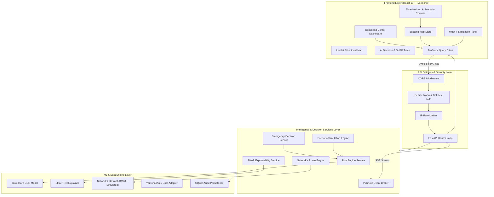
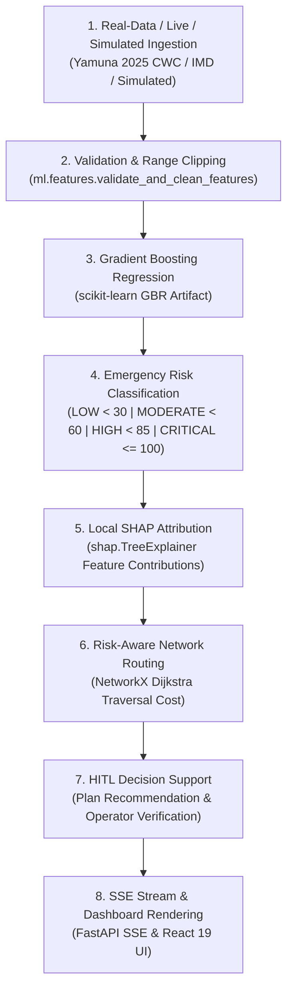
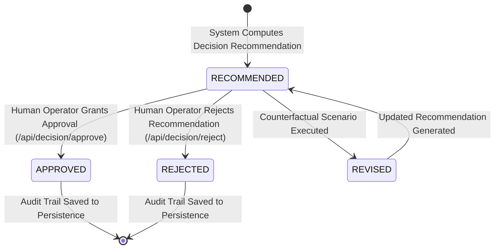

# AapdaNetra-X — System Architecture & Technical Specifications

**Disaster Intelligence & Emergency Response Platform — System Architecture & Component Design**

> [!NOTE]
> **Research Prototype Disclaimer**: AapdaNetra-X is operating in **Research-Grade Local Prototype Mode**. Models and route calculations are evaluated for demonstration and software architecture validation, **not** for real-world emergency life-safety deployment.

---

## 1. High-Level System Architecture

AapdaNetra-X follows a decoupled full-stack architecture comprising a **FastAPI Intelligence & Decision Engine** backend and a **React 19 Command Center Dashboard** frontend.

---

## 2. 7-Feature Risk Engine Pipeline

The core intelligence engine transforms 7 physical parameters into risk predictions:

1. `rainfall_intensity` (mm/h)
2. `rainfall_trend` (mm/h²)
3. `water_level` (m above datum)
4. `water_level_trend` (m/h)
5. `road_congestion` (ratio $0.0 - 1.0$)
6. `population_exposure` (headcount)
7. `infrastructure_vulnerability` (ratio $0.0 - 1.0$)

---

## 3. Human-in-the-Loop (HITL) Emergency Decision Lifecycle

Emergency decision recommendations generated by `compute_emergency_decision` require explicit operator verification:

---

## 4. Multi-Hazard Capability Matrix & Unsupported-Hazard Safeguards

AapdaNetra-X enforces a strict multi-hazard capability guardrail:

| Hazard Type | Model Status | Operational Endpoint | Behavior / Disclaimer |
| :--- | :--- | :--- | :--- |
| **Riverine Flood** | Operational | `/api/risk`, `/api/decision` | Returns GBR ML risk, SHAP attributions, and evacuation paths. |
| **Flash Flood** | Operational (Hybrid) | `/api/risk`, `/api/simulation` | Evaluates rapid rainfall escalation rates (`rainfall_trend`). |
| **Earthquake** | Unsupported | `/api/decision/recommend` | Returns `decision_support_available: False`, disclaimer `UNSUPPORTED_HAZARD`. |
| **Landslide** | Unsupported | `/api/decision/recommend` | Returns `decision_support_available: False`, disclaimer `UNSUPPORTED_HAZARD`. |
| **Cyclone** | Unsupported | `/api/decision/recommend` | Returns `decision_support_available: False`, disclaimer `UNSUPPORTED_HAZARD`. |

---

## 5. Security Architecture & Rate Limiting

1. **Authentication**: Optional/Enforced Bearer Token and `X-API-Key` headers evaluated via `app.core.security`.
2. **Role-Based Access Control (RBAC)**: State-changing decision endpoints (`/api/decision/approve`, `/api/decision/reject`) require `responder` or `admin` role token.
3. **CORS Hardening**: Strict origin white-listing (`settings.cors_origins`). Capped request body sizes ($1\text{ MB}$ max).
4. **Rate Limiting**: Sliding window IP rate limiter returning HTTP 429 when threshold exceeded.
5. **SSE Connection Bounds**: Maximum subscriber limits per IP (`max_sse_subscriptions_per_ip = 2`).
6. **Error Response Sanitization**: Suppresses stack traces, database strings, and filesystem paths in 4xx/5xx API responses.

---

## 6. Empirical Subsystem Benchmarks

* **ML Prediction Latency**: **0.419 ms / op**
* **SHAP Attribution Latency**: **0.516 ms / op**
* **Risk Engine State Latency**: **0.846 ms / op**
* **Decision Service Latency**: **1.794 ms / op**
* **Simulation Engine Latency**: **3.508 ms / op**
* **Total E2E Execution Pipeline**: **< 10.0 ms**
